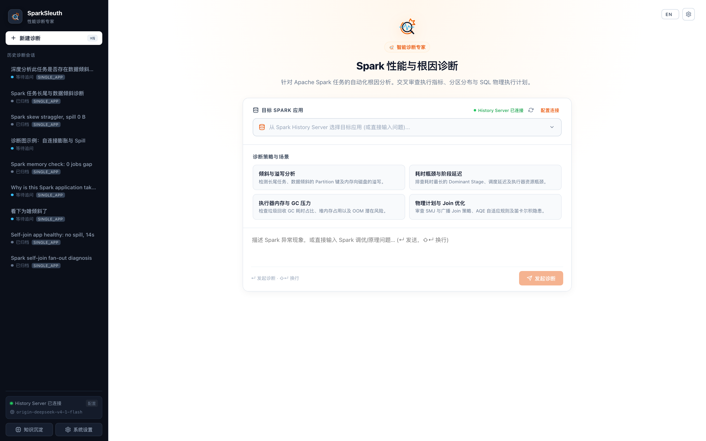

<p align="center">
  
</p>

# SparkSleuth

**An AI diagnostic assistant for Apache Spark.** Give it an appId, or just ask "why was this job slow?" — it walks the evidence chain on its own and comes back with a report you can act on.

> Status: v0.1 — works end to end against a live History Server with bilingual UI and comprehensive rule verification.



<p align="center">
  <em>SparkSleuth clean home dashboard with quick diagnostic playbooks, application selector, and bilingual support.</em>
</p>

---

## Key Interface & Capabilities

### Investigation Workspace


### Searchable Application Selector


### Visual Settings & Connection Ping


### Long-Term Memory & Candidate Rules


### Case Report & Deep Dive


- **Evidence-Driven Investigation Workspace**: The agent conducts autonomous step-by-step investigations with transparent reasoning traces, tool call groupings, and an interactive Inspector with draggable widths.
- **Searchable Application Selector**: Fuzzy-search live and completed applications directly from Spark History Server with status badges and execution metrics.
- **Visual System Configuration**: Configure Spark History Server URLs, LLM model gateways, API keys, and security tokens directly from the UI with real-time connectivity and latency ping.
- **Long-Term Memory & Auto-Dream**: Tri-level memory architecture that stores case reports and distills candidate rules with human-in-the-loop review (Approve / Reject) and instant tab navigation.
- **Full Bilingual Support**: Default Chinese (`zh`) interface with instant English (`en`) toggling via the top-right button, persisted across sessions.

---

## Why

Diagnosing a slow or failing Spark job follows a well-known path, but doing it by hand is slow:

- metrics are scattered across a pile of History Server endpoints that you compare by eye;
- "is this data skew?" needs task quantiles, shuffle I/O, GC and the physical plan looked at together;
- the same pitfalls get rediscovered by every engineer;
- the experienced person gets it right, but can't be everywhere.

SparkSleuth turns that into one conversation. **Rules do the arithmetic; the model does the reasoning.**

## How it works

```
Web UI (React)  ──WebSocket──▶  Control layer (Node.js)
                                   │
                                   ▼
                            Agent runtime (own ReAct loop)
                                   │
                                   ▼
                            Skills (spark-history, spark-diagnose, …)
                                   │
                                   ▼
                            Spark History Server (read-only)
```

- **Rules + model, two tracks.** Spill ratio, skew factor and join fan-out are computed deterministically by a rule engine. The model links the evidence, explains the cause, and writes the fix.
- **Progressive disclosure.** Only one-line skill descriptions sit in the prompt; tool schemas and full results are loaded on demand. Large results go to disk and are queried locally — they never flood the context.
- **Evidence-first.** Every conclusion carries the tool name and the numbers behind it.
- **Read-only by default.** Phase one touches nothing but the History Server.

## What it looks at

| Layer | Signal |
|---|---|
| App overview | failures, slowest stages, executor health, spill/shuffle/GC totals |
| Stage & task | quantiles, long-tail factor, GC, spill, shuffle skew |
| Physical plan | join shape, row fan-out, exchanges, scan size and file count |
| Data & config | partition counts, key distribution, AQE and memory settings |
| Recommendations | SQL rewrite and parameter changes, ranked P0–P2, with expected gain |

Twelve built-in rules cover stage dominance, heavy spill, task and shuffle skew, join explosion, broadcast-nested-loop joins, broadcastable sort-merge joins, GC pressure, executor loss, task failures, small files and risky configs.

## Quick start

Requires Node.js 23.4+ (the control layer persists to the built-in `node:sqlite`) and pnpm 10.

```bash
# 1. point it at a model gateway (any Anthropic-compatible endpoint)
export SPARKSLEUTH_LLM_BASE_URL=https://api.anthropic.com
export SPARKSLEUTH_LLM_API_KEY=sk-...
export SPARKSLEUTH_LLM_MODEL=claude-sonnet-4-5

# 2. point it at your History Server
export SPARKSLEUTH_HS_URL=http://localhost:18080

# 3. run
pnpm install
pnpm dev        # server on :8787, web on :5173
```

Open http://localhost:5173 and ask about an application. For a single port, build
the web UI first and let the server serve it:

```bash
pnpm build && pnpm start   # http://localhost:8787
```

No History Server handy? `testenv/` spins one up locally with ten jobs built to
trip — or deliberately not trip — each rule:

```bash
./testenv/start-hs.sh
./testenv/run-all.sh
```

| Job | Failure Mode | Triggered Rules |
|---|---|---|
| `j1_self_join_explosion` | Many-to-many join row fanout (3.2M → 78M) | `JOIN_EXPLOSION`, `SPILL_HEAVY` |
| `j2_skew_join` | Hot key with AQE disabled | `SHUFFLE_SKEW`, `SPILL_HEAVY`, `CONF_CHECK` |
| `j3_bnlj` | Non-equi join falling back to broadcast nested loop | `BNLJ`, `CONF_CHECK` |
| `j4_small_files` | 2,000 tiny files causing scan metadata pressure | `SMALL_FILES` |
| `j5_task_failures` | Deliberate task exceptions and stage retries | `TASK_FAILURES` |
| `j6_healthy` | Well-behaved baseline job | *none* |
| `j7_self_join_optimized` | Same workload as j1 with Top-N window cap | *none* |
| `j8_smj_broadcastable` | SortMergeJoin on tiny dimension table (< 50 KB) | `SMJ_BROADCASTABLE` |
| `j9_straggler_skew` | Extreme key skew where one task straggles (> 5s) | `TASK_SKEW`, `SHUFFLE_SKEW`, `CONF_CHECK` |
| `j10_stage_dominant` | Multi-stage pipeline where a single stage dominates (> 30s) | `STAGE_DOMINANT` |

Verify all fixture jobs in one shot:
```bash
pnpm --filter @sparksleuth/skills-spark exec tsx scripts/verify-fixtures.ts
```

Prefer the terminal? The CLI drives the same agent runtime:

```bash
pnpm cli apps
pnpm cli diagnose <appId> "why is this slow?"
pnpm cli call spark_history_stage_detail '{"appId":"...","stageId":3}'
```

## Security & Authentication

SparkSleuth binds to `127.0.0.1` by default. When deployed into containers or bound to `0.0.0.0`, configure `SPARKSLEUTH_TOKEN`:

```bash
export SPARKSLEUTH_HOST=0.0.0.0
export SPARKSLEUTH_TOKEN=your-secure-secret-token
```

Clients pass the token via `Authorization: Bearer <token>`, header `x-sparksleuth-token: <token>`, or query parameter `?token=<token>`. The web frontend provides a token modal if authentication is required.

## Documentation

- [Design Document (English)](docs/design.en.md) / [设计文档 (中文)](docs/design.md) — architecture, agent runtime, rules, memory
- [Rules Guide](docs/rules.md) — each rule's threshold, evidence and rationale
- [Skills Specification](docs/skills.md) — how to add a new observation source
- [A/B Comparison Tool](packages/skills-spark/src/tools/index.ts) — comparing baseline vs experiment runs
- [Contributing Guidelines](CONTRIBUTING.md) — setting up development and contributing PRs
- [Agent Guide](AGENTS.md) — architectural invariants and conventions for AI coding agents
- [Test Environment](testenv/README.md) — local History Server and fixture jobs

## Roadmap

| Version | Focus |
|---|---|
| v0.1 | History Server skills, rule engine, agent runtime, web UI, three-tier memory |
| v0.2 | A/B validation runs (sandboxed writes only) |
| v0.3 | More sources: YARN, metadata, lakehouse query engine, scheduler, logs |
| v0.4 | Vector search over memory, multi-user, Docker |

## License

Apache-2.0
